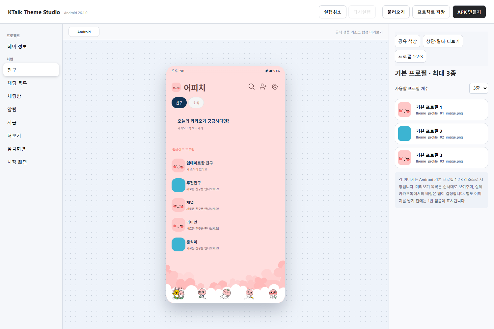
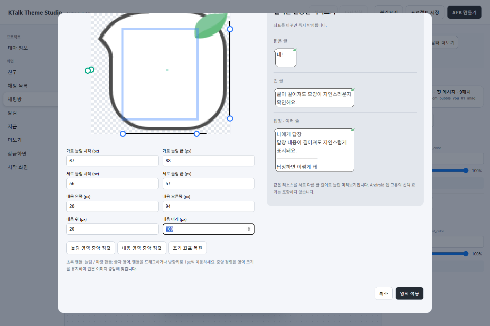

<p align="center">
  
</p>

# Kongeuni KT Maker

콩으니의 Windows용 **안드로이드 카카오톡 테마 편집기**입니다.
화면 미리보기에서 요소를 선택하고, 색상과 이미지를 바꾼 뒤 APK를 만들 수 있습니다.



미리보기 이미지는 기능 확인에 사용한 개발 화면으로, 일부 이전 표시명이 보일 수 있습니다.

## 주요 기능

- 친구·채팅 목록·채팅방·더보기·잠금화면 등 화면별 미리보기
- 같은 색상을 묶어서 편집하고 투명도 조절
- 기본 프로필 최대 3종, 배경·아이콘·말풍선 이미지 교체
- 나인패치 늘림/내용 영역 드래그 편집과 실시간 미리보기
- 나인패치 좌표 전체 복사·붙여넣기 및 이미지 교체 시 좌표 유지
- 실행취소·다시실행, 프로젝트 저장·불러오기
- 테마 이름·아이콘·버전·앱 식별자 설정과 APK 내보내기



## 개발 환경에서 실행

Node.js와 npm을 설치한 뒤 실행합니다.

```sh
npm ci
npm start
```

APK 빌드에는 **JDK 21**, Android SDK Platform 35와 Build Tools 35.0.0이 필요합니다.
Android Studio SDK Manager에서 구성하고 라이선스를 확인하세요.
`ANDROID_HOME`으로 SDK 위치를 지정할 수 있습니다.
Gradle과 의존성은 첫 빌드 때 내려받으므로 인터넷 연결이 필요합니다.

## Windows 실행본 만들기

```sh
npm run package
```

`dist/KTalkThemeStudio-win32-x64/`에 실행 폴더가 생성됩니다.
실행 파일만 분리하지 말고 폴더 전체를 함께 사용하세요.

## 프로젝트와 기본 정보

작업은 `.ktstudio` 파일로 저장합니다. APK 빌드 전에는 자동 백업도 생성됩니다.
실행취소 기록은 현재 실행 중에만 유지됩니다.

새 프로젝트의 기본 제작자는 `콩으니`, 버전 표시명은 `Kongeuni`,
앱 식별자는 `KongeuniThema.NewThema`입니다. 배포할 테마마다 식별자를 바꿔주세요.

## 참고

Android 26.1.0 샘플 리소스를 기반으로 제작했습니다.
미리보기와 실제 카카오톡의 일부 고정 UI는 버전·기기에 따라 다를 수 있습니다.
미리보기용 서비스 아이콘에는 직접 그린 벡터가 포함됩니다.

이 프로젝트는 Kakao의 공식 제품이 아닙니다.
포함된 Kakao 샘플·캐릭터 리소스의 권리는 해당 권리자에게 있습니다.
사용자가 추가하는 이미지와 로고는 각 권리자의 사용 조건을 따라주세요.
